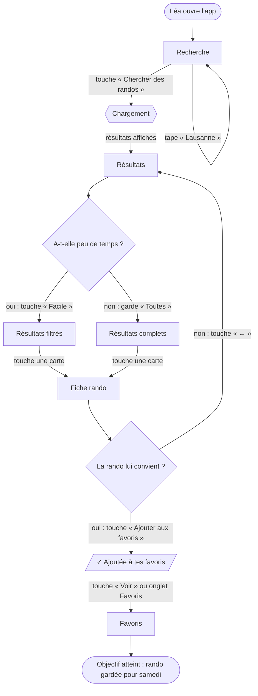

# User flow — Balado

**Application :** Balado
**Objectif :** trouver rapidement une petite randonnée près de chez soi, accessible en transports publics, et la garder en favori.
**Plateforme :** mobile

**Persona :** Léa, 17 ans, apprentie à Lausanne. Pas de voiture, peu de temps libre. À l'aise avec son téléphone, mais veut aller vite. → voir [`persona.md`](persona.md)

**Scénario :** Léa veut trouver une rando pour samedi et la garder.
- **Début :** ouverture de l'app
- **Fin :** la rando apparaît dans ses favoris

---

## 1. Tableau du parcours (chemin heureux)

| N° | Action de l'utilisateur | Écran | Feedback attendu | Ressenti de Léa |
|---|---|---|---|---|
| 1 | Ouvre l'app Balado | **Recherche** : point de départ, saisir un lieu | L'app s'ouvre directement sur le champ de recherche, avec ses recherches récentes | « Ok, pas de compte à créer, je peux commencer direct. » 🙂 |
| 2 | Touche le champ et tape « Lausanne » | **Recherche** | Le clavier s'ouvre et des suggestions de lieux apparaissent pendant qu'elle tape | « Pratique, je n'ai même pas besoin de tout écrire. » |
| 3 | Touche « Chercher des randos » | **Recherche** → **Résultats** | Bref chargement (cartes grises), puis la liste s'affiche : « 8 randos trouvées », de la plus facile à la plus difficile | ⚠️ « Si ça charge longtemps, je décroche. » |
| 4 | **Décision** : elle n'a que l'après-midi, alors elle touche la puce « Facile » | **Résultats** : comparer et filtrer | La liste se met à jour tout de suite et la puce « Facile » passe en noir | « Parfait, je ne vois que ce qui me va. » 🙂 |
| 5 | Parcourt les cartes (durée, difficulté, gare de départ) | **Résultats** | Chaque carte montre les infos clés sans avoir à l'ouvrir | ⚠️ « Je veux savoir vite si c'est accessible en bus. » |
| 6 | Touche la carte « Bois de Sauvabelin » | **Résultats** → **Fiche rando** | La fiche s'ouvre avec la photo, la durée, la distance, le dénivelé, le départ et la description | « 1 h 30, départ arrêt Sallaz, c'est jouable. » |
| 7 | **Décision** : la rando lui convient, alors elle touche « Ajouter aux favoris » | **Fiche rando** : vérifier puis garder | Le bouton devient « ♥ Dans tes favoris » et un message « ✓ Ajoutée à tes favoris · Voir » s'affiche 3 s | « Super, c'est enregistré. » 😊 |
| 8 | Touche « Voir » (ou l'onglet Favoris) | **Fiche rando** → **Favoris** | La liste de ses favoris s'affiche, avec la nouvelle rando en haut | « Samedi, je la retrouve en un clic. » ✅ **Objectif atteint** |

---

## 2. Diagramme Mermaid

> Pour le visualiser : coller le code sur https://mermaid.live (GitHub l'affiche aussi automatiquement).

---

## 3. Liste des écrans (pour le wireframe)

1. **Recherche** : saisir un lieu de départ (écran d'accueil).
2. **Résultats** : voir et filtrer les randos proches par difficulté.
3. **Fiche rando** : vérifier les détails et ajouter aux favoris.
4. **Favoris** : retrouver les randos gardées.

---

## 4. Points de friction et solutions

- **Le temps de chargement (étape 3)** peut faire décrocher Léa : on affiche des cartes « squelette » tout de suite, et les données restent locales, donc c'est rapide.
- **Le doute sur l'accès en transports (étape 5)** : la gare ou l'arrêt de départ est écrit directement sur chaque carte, sans avoir à ouvrir la fiche.
- **La peur que le favori ne soit pas enregistré (étape 7)** : il y a une double confirmation, avec le bouton qui change et un message « Ajoutée · Voir » qui mène droit aux Favoris.
